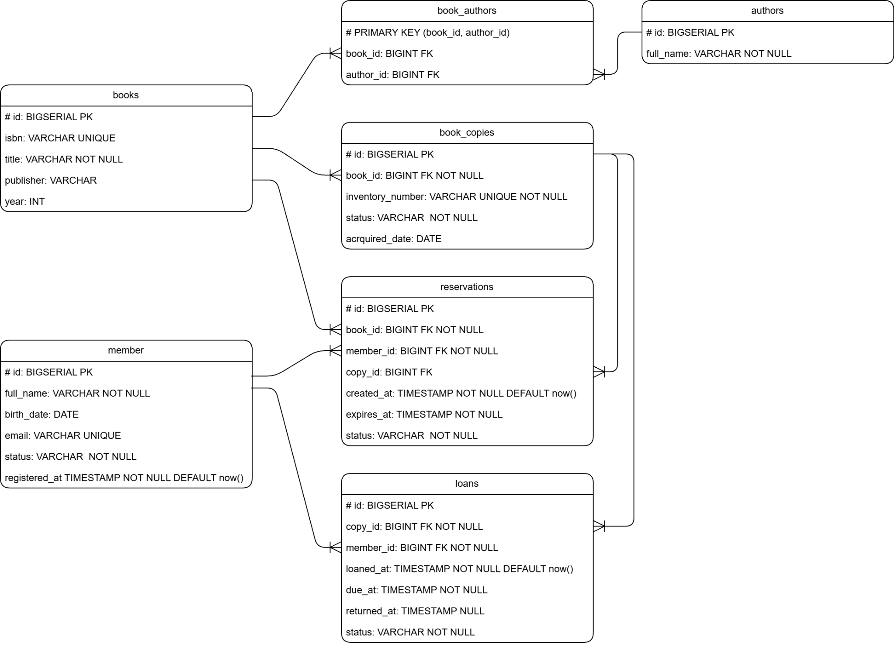
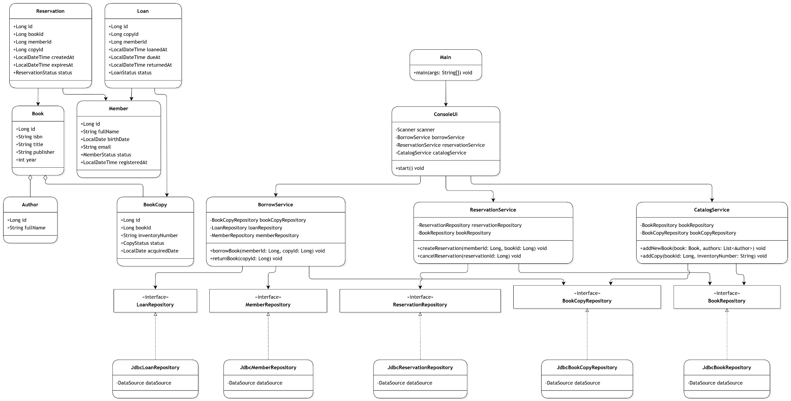

# Library Management

Консольное backend-приложение для автоматизации библиотечного учёта. Проект написан на **Java 17** с использованием JDBC и PostgreSQL.

Система позволяет вести каталог книг и авторов, управлять физическими экземплярами, регистрировать читателей, оформлять бронирования, выдавать и возвращать книги.


## Содержание

- [Технологический стек](#технологический-стек)
- [Архитектура и диаграммы](#архитектура-и-диаграммы)
  - [ER-диаграмма базы данных](#1-er-диаграмма--структура-базы-данных)
  - [Диаграмма классов](#2-диаграмма-классов--архитектура-приложения)
- [Основные возможности](#основные-возможности)
- [Запуск проекта](#запуск-проекта)
- [Структура проекта](#структура-проекта)
- [Конкурентная выдача](#конкурентная-выдача)
- [Тестирование](#тестирование)
- [Переменные окружения](#переменные-окружения)

## Технологический стек

| Технология | Назначение |
|---|---|
| Java 17 | Основной язык разработки |
| Gradle 9.8.2 | Сборка и управление зависимостями |
| PostgreSQL 17 | Реляционная база данных |
| Docker Compose | Запуск PostgreSQL в контейнере |
| JDBC | Работа с базой данных без ORM |
| HikariCP | Пул подключений к БД |
| Flyway | Версионирование и автоматическое применение SQL-миграций |
| JUnit 5 | Модульное и интеграционное тестирование |

Проект использует Gradle Wrapper: устанавливать Gradle вручную не требуется. IntelliJ IDEA сможет загрузить нужную версию Gradle и зависимости при импорте проекта.

## Архитектура и диаграммы

В проекте используется **слоистая архитектура (Layered Architecture)**. Консольный интерфейс взаимодействует с сервисами, сервисы работают через интерфейсы репозиториев, а JDBC-реализации репозиториев отвечают за SQL и преобразование результатов запросов в Java-объекты.

### 1. ER-диаграмма — структура базы данных

ER-диаграмма описывает основные сущности библиотеки, их атрибуты и связи между таблицами. Она отражает не только каталог книг, но и физический фонд, читателей, бронирования и историю выдач.

<p align="center">
  
</p>
<p align="center"><em>Рисунок 1 — ER-диаграмма базы данных библиотечной системы.</em></p>

**Ключевые связи:**

- `books` ↔ `authors` — связь многие-ко-многим через таблицу `book_authors`: у книги может быть несколько авторов, а один автор может написать несколько книг.
- `books` → `book_copies` — связь один-ко-многим: библиографическая запись описывает книгу, а `book_copies` хранит её физические экземпляры.
- `members` → `loans` — читатель может иметь несколько записей о выдаче.
- `book_copies` → `loans` — для одного экземпляра хранится история выдач; одновременно активной может быть только одна.
- `members` и `books` связаны с `reservations`: бронь создаётся читателем на конкретную книгу. Поле `copy_id` позволяет при необходимости привязать бронь к определённому экземпляру.

ER-диаграмма показывает логическую модель. Фактические имена полей и дополнительные ограничения реализации зафиксированы в миграции [`V1__create_library_schema.sql`](src/main/resources/db/migration/V1__create_library_schema.sql). Например, в SQL используется таблица `members` и поле `publication_year`.

### 2. Диаграмма классов — архитектура приложения

Диаграмма классов показывает, как предметная модель и операции библиотечной системы распределены между Java-классами. Отдельно выделены точка входа и пользовательский интерфейс, сервисы бизнес-логики, интерфейсы репозиториев и их JDBC-реализации.

<p align="center">
  
</p>
<p align="center"><em>Рисунок 2 — Диаграмма классов и слоёв приложения.</em></p>

**Назначение основных частей:**

| Слой | Классы | Ответственность |
|---|---|---|
| Точка входа и UI | `Main`, `ConsoleUI` | Создание объектов приложения, меню и взаимодействие с пользователем |
| Model | `Book`, `Author`, `BookCopy`, `Member`, `Loan`, `Reservation` | Представление предметных сущностей |
| Enums | `CopyStatus`, `LoanStatus`, `MemberStatus`, `ReservationStatus` | Допустимые состояния экземпляров, выдач, читателей и броней |
| Service | `BorrowService`, `ReservationService`, `CatalogService`, `MemberService` | Бизнес-правила и сценарии работы библиотеки |
| Repository | `BookRepository`, `BookCopyRepository`, `MemberRepository`, `LoanRepository`, `ReservationRepository` | Контракты доступа к данным |
| JDBC | `JdbcBookRepository`, `JdbcBookCopyRepository` и остальные `Jdbc*Repository` | SQL-запросы и преобразование данных между PostgreSQL и Java-моделями |
| Infrastructure / Config | `DatabaseConnection`, `TransactionManager`, `FlywayMigration` | Пул соединений, управление транзакциями и миграции БД |

Такое разделение позволяет менять способ хранения данных, не перенося SQL в сервисы, а также тестировать бизнес-логику независимо от консольного интерфейса.

## Основные возможности

- Просмотр каталога книг и физических экземпляров.
- Добавление книг и авторов, регистрация новых экземпляров.
- Регистрация читателей и просмотр списка читателей.
- Выдача экземпляра читателю и оформление возврата.
- Создание и отмена бронирований.
- Учёт статусов экземпляров, читателей, выдач и бронирований.
- Автоматическое применение миграций при запуске приложения.

## Запуск проекта

### Требования

- JDK 17 или новее.
- Docker Desktop или Docker Engine с Docker Compose.
- IntelliJ IDEA (для разработки; необязательна для запуска через Gradle).

### 1. Получение проекта и настройка БД

Клонируйте репозиторий или распакуйте архив, затем перейдите в корневую папку проекта.

При необходимости создайте `.env` на основе примера:

**Linux / macOS:**

```bash
cp .env.example .env
```

**Windows PowerShell:**

```powershell
Copy-Item .env.example .env
```

Файл `.env` необязателен: без него используются значения по умолчанию из таблицы [переменных окружения](#переменные-окружения).

Запустите PostgreSQL:

```bash
docker compose up -d --wait
```

Контейнер `library-management-db` будет доступен на `localhost:5432`. Данные сохраняются в Docker volume `library_postgres_data`.

### 2. Импорт в IntelliJ IDEA

1. Откройте папку `library-management` в IntelliJ IDEA.
2. Подтвердите импорт Gradle-проекта, если IDE предложит его.
3. Установите Gradle JVM не ниже Java 17.
4. Дождитесь загрузки Gradle и зависимостей.

Gradle Wrapper автоматически загрузит Gradle указанной в проекте версии. Отдельная установка Gradle не нужна.

### 3. Запуск приложения

Через Gradle:

**Linux / macOS:**

```bash
./gradlew run
```

**Windows:**

```powershell
.\gradlew.bat run
```

Также можно запустить класс `ru.library.management.Main` непосредственно из IntelliJ IDEA.

При старте приложение подключается к PostgreSQL, применяет миграции Flyway из `src/main/resources/db/migration` и запускает консольное меню.

## Структура проекта

```text
library-management/
├── docs/
│   ├── ER.png                         # ER-диаграмма БД
│   ├── class-diagram.png              # диаграмма классов
├── gradle/wrapper/                    # Gradle Wrapper
├── src/
│   ├── main/
│   │   ├── java/ru/library/management/
│   │   │   ├── config/                # подключение к БД
│   │   │   ├── exception/             # исключения приложения
│   │   │   ├── infrastructure/        # транзакции и миграции
│   │   │   ├── model/                 # сущности и перечисления
│   │   │   ├── repository/            # интерфейсы репозиториев
│   │   │   │   └── jdbc/              # JDBC-реализации
│   │   │   ├── service/               # бизнес-логика
│   │   │   ├── ui/                    # консольный интерфейс
│   │   │   └── Main.java              # точка входа
│   │   └── resources/db/migration/    # SQL-миграции Flyway
│   └── test/                          # модульные и интеграционные тесты
├── .env.example                       # пример настроек БД
├── build.gradle
├── docker-compose.yml
├── gradlew
└── gradlew.bat
```

## Конкурентная выдача

Метод `BorrowService.borrowBook(memberId, copyId)` выполняет выдачу в рамках одной транзакции:

1. Проверяет, что читатель существует и его аккаунт активен.
2. Получает экземпляр через `BookCopyRepository.findByIdForUpdate()`.
3. PostgreSQL блокирует выбранную строку с помощью `SELECT ... FOR UPDATE`.
4. После получения блокировки сервис проверяет, что экземпляр имеет статус `AVAILABLE`.
5. Создаёт запись о выдаче в `loans` и меняет статус экземпляра на `LOANED`.
6. Фиксирует транзакцию. При ошибке выполняется `ROLLBACK`.

Если два потока одновременно пытаются выдать один экземпляр, второй поток ожидает снятия блокировки. После этого он читает актуальное состояние экземпляра и не сможет выдать его повторно.

В качестве дополнительной гарантии в PostgreSQL создан частичный уникальный индекс `uq_loans_one_active_per_copy`. Он не позволяет сохранить больше одной активной или просроченной выдачи для одного экземпляра, даже если запросы поступят в обход бизнес-логики приложения.

## Тестирование

Запуск модульных тестов:

**Linux / macOS:**

```bash
./gradlew test
```

**Windows PowerShell:**

```powershell
.\gradlew.bat test
```

Интеграционный тест `BorrowServiceConcurrencyTest` проверяет конкурентную выдачу с использованием отдельной PostgreSQL. Чтобы запустить его, создайте тестовую БД:

```bash
docker compose exec postgres createdb -U library_user library_test
```

Затем задайте `DB_TEST_URL`.

**Linux / macOS:**

```bash
DB_TEST_URL=jdbc:postgresql://localhost:5432/library_test ./gradlew test
```

**Windows PowerShell:**

```powershell
$env:DB_TEST_URL = "jdbc:postgresql://localhost:5432/library_test"
.\gradlew.bat test
```

По умолчанию тест использует `DB_TEST_USER=library_user` и `DB_TEST_PASSWORD=library_password`. При отсутствии `DB_TEST_URL` интеграционный тест автоматически пропускается. Тест создаёт записи в отдельной тестовой БД и не очищает их после выполнения.

## Полезные команды

| Команда | Назначение |
|---|---|
| `docker compose up -d --wait` | Запустить PostgreSQL и дождаться готовности |
| `docker compose logs -f` | Посмотреть логи контейнера БД |
| `docker compose down` | Остановить контейнер, сохранив данные volume |
| `docker compose down -v` | Остановить контейнер и удалить данные БД |
| `./gradlew test` | Запустить тесты |
| `./gradlew run` | Запустить приложение |
| `./gradlew clean build` | Очистить и собрать проект |

В Windows используйте `gradlew.bat` вместо `./gradlew`.

## Переменные окружения

| Переменная | Значение по умолчанию | Назначение |
|---|---|---|
| `DB_URL` | `jdbc:postgresql://localhost:5432/library_db` | JDBC URL базы данных приложения |
| `DB_USER` | `library_user` | Пользователь PostgreSQL |
| `DB_PASSWORD` | `library_password` | Пароль PostgreSQL |
| `DB_NAME` | `library_db` | Имя БД, создаваемой Docker Compose |
| `DB_TEST_URL` | — | JDBC URL отдельной БД для интеграционного теста |
| `DB_TEST_USER` | `library_user` | Пользователь тестовой БД |
| `DB_TEST_PASSWORD` | `library_password` | Пароль тестовой БД |

Настройки приложения можно передать через переменные окружения или файл `.env` в корне проекта. Значения в `.env.example` предназначены только для локального учебного запуска. Не добавляйте настоящий `.env` с личными паролями в Git — он уже исключён через `.gitignore`.
